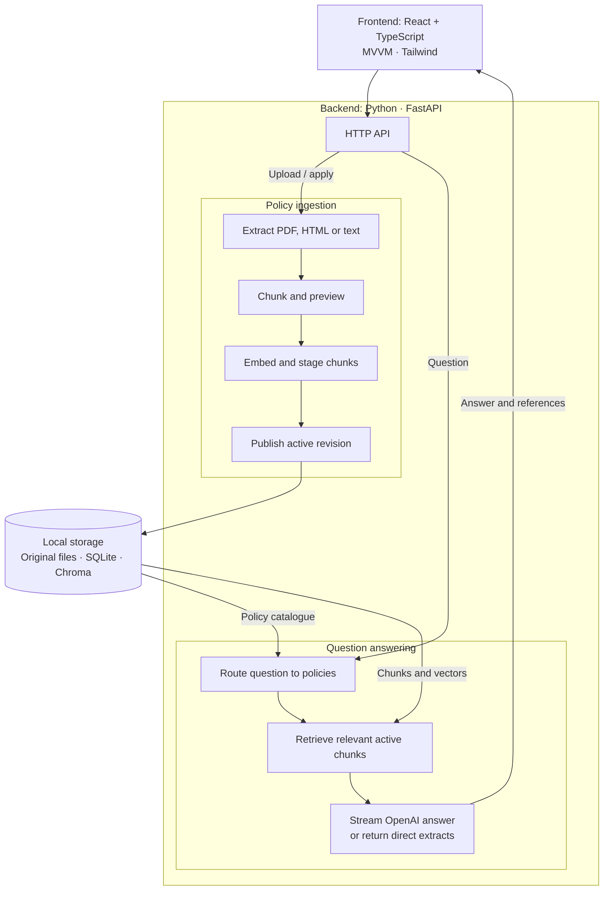

# NorthStar Policy Desk

A demo internal policy app that answers workplace questions using retrieval-augmented generation (RAG), with source passages you can inspect.

**NorthStar is a fictional company. All bundled policies and examples are made up for this demo.**

## What it does

- **Ask questions:** stream an OpenAI answer or read direct policy extracts, with citations and supporting passages.
- **Manage policies:** upload PDF, HTML or text files; read, rename and delete policies.
- **Inspect retrieval:** browse chunks and preview changes to character, sentence, paragraph or HTML-section splitting before applying them.
- **Evaluate RAG:** explore five questions of increasing complexity, with five RAGAS metrics and a separate LLM judge. See [evaluation details](docs/evaluation.md).
- **Use any screen:** responsive layouts, light/dark themes and loading skeletons.

The sample corpus covers AI acceptable use, information security and an employee handbook.

## See it in action

[](docs/media/live-question-demo.webm)

[Watch the full-resolution video](docs/media/live-question-demo.webm) · [Browse screenshots](docs/media/README.md#screenshots)

- Recorded with Playwright against the running app.
- Uses a real OpenAI response and the fictional sample policies; no mocked answers.

## Run locally

**Requirements:** Python 3.12 and Node.js 22.19+ within the Node 22 line. The pinned environment is tested on Linux/WSL.

```bash
git clone https://github.com/ZakYeo/policy-rag-assistant.git
cd policy-rag-assistant
python3.12 -m venv .venv
source .venv/bin/activate

python scripts/check_python_release_dates.py
python -m pip install --no-deps -r requirements-ci.txt
python -m pip install --no-deps --no-build-isolation -e .

cd frontend
node tooling/check-release-dates.mjs
npm ci
npm run build
cd ..

cp .env.example .env
```

- Set `OPENAI_API_KEY` in `.env`. Credentials stay on the backend.
- The date checks verify dependencies were released at least four days before installation, using the repository's frozen cutoff.
- No API key? Follow the [local-only setup](docs/development.md#run-without-openai).

```bash
uvicorn app.main:app --reload
```

Open **[localhost:8000](http://localhost:8000)**. The three sample PDFs are imported and indexed automatically on first use.

- Try: **“Can I put customer data into a public AI tool?”**
- Open **Manage policies** to inspect the documents and experiment with chunking.

## How it works



- **Ingestion:** previewing leaves search unchanged; applying publishes a revision after indexing succeeds.
- **Retrieval:** questions search active chunks from the selected policies. Answers include source references.
- **Defaults:** local embeddings, OpenAI routing and OpenAI answers. [Provider configuration](docs/development.md#configuration).

## Documentation

- [Development guide](docs/development.md): configuration, API examples, CLI ingestion and test commands.
- [Policy management](docs/policy-management.md): upload limits, chunking strategies, revisions and storage.
- [Validation notes](validation/README.md): test coverage, dependency checks and review results.
- [Demo media](docs/media/README.md): screenshots and reproducible capture instructions.

## Demo limits

- No authentication or multi-user permissions; run one local app process.
- No conversation history, OCR or Word-document support.
- Generated guidance can be wrong; the source passages are available for checking.
